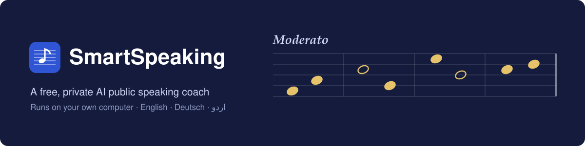
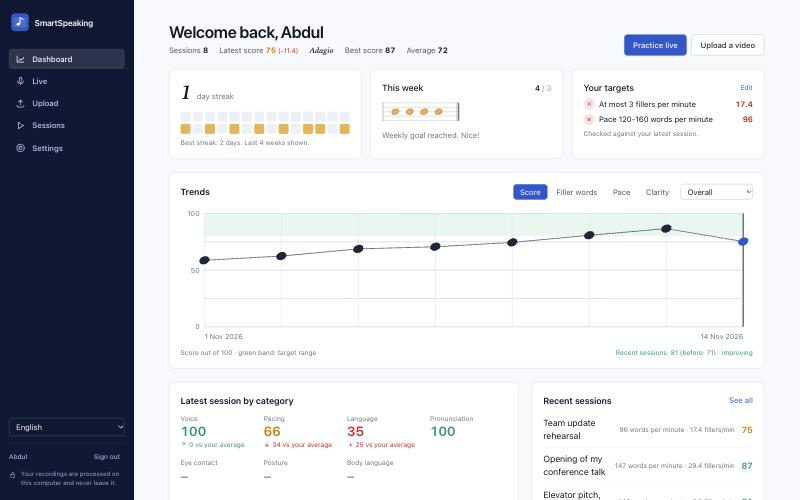
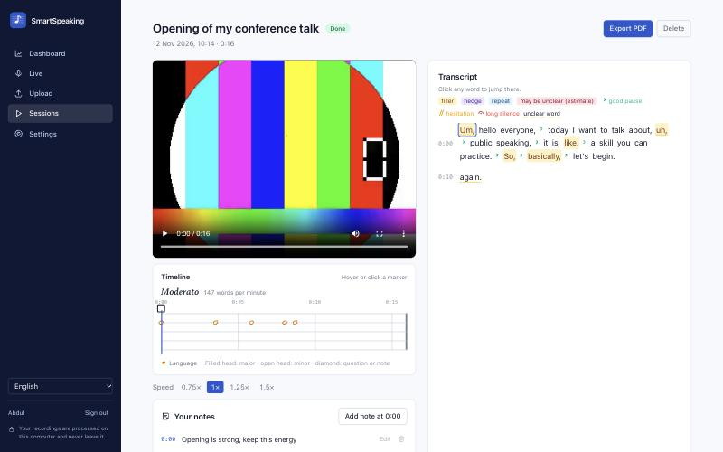
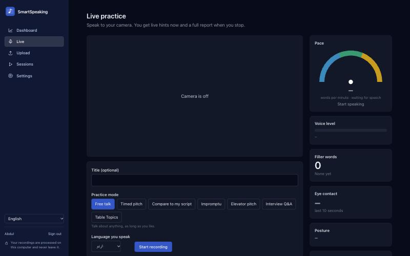
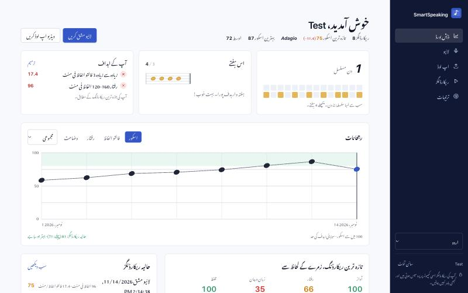
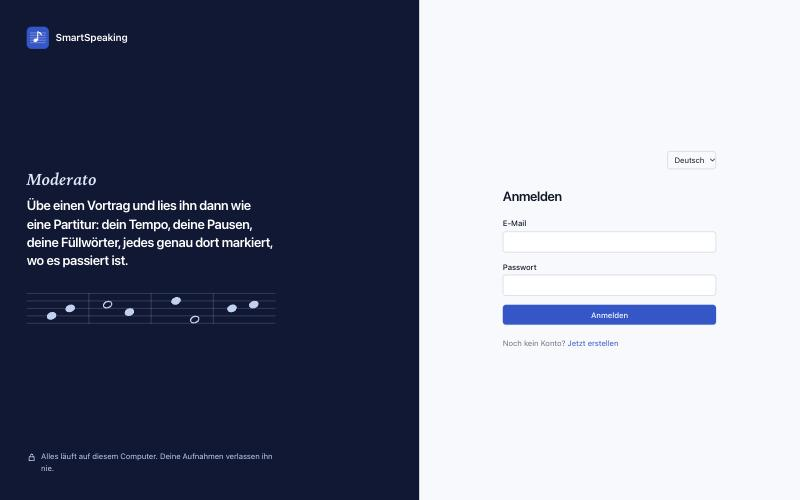

<p align="center">
  
</p>

<p align="center">
  <b>Record a talk. Read it back like a score.</b><br>
  Pace, pauses, filler words, voice, eye contact and posture, each one marked at the moment it happened,<br>
  with drills to fix it. Everything runs on your own computer, with free open-source models.
</p>

<p align="center">
  
  
  
  
</p>

<p align="center">
  <a href="#quick-start-docker">Quick start</a> ·
  <a href="#what-it-does">What it does</a> ·
  <a href="#screenshots">Screenshots</a> ·
  <a href="#models">Models</a> ·
  <a href="#limitations">Limitations</a>
</p>

<p align="center">
  
</p>

## What it does

| | |
| --- | --- |
| 🎙️ **Practice live** | Speak to your webcam and get live hints: a pace speedometer with a tempo marking, voice level, pause timer, filler-word alerts (optional soft beep), eye contact, posture and expression, with tracking boxes around face, hands and body. |
| 🎯 **Seven practice modes** | Free talk, timed pitch, script rehearsal, **impromptu** (random topic, 30 s to think), **elevator pitch** (30 or 60 s), **interview Q&A** (questions on demand) and **Table Topics** with Toastmasters timing lights. Topics and questions in all three languages. |
| 📜 **Script rehearsal** | Write, paste or open a script and read it from a teleprompter that follows your voice. Afterwards, see every skipped, changed and added passage, each linked to the video. |
| 📊 **A full report** | Scores per category, strengths, gaps and top fixes; voice delivery (pitch variation, monotone, volume, pauses); body language (eye contact, gestures, open palms, posture, fidgeting); emotions; sentence-clarity rewrites; a highlighted transcript. |
| 🎼 **Playback as a score** | The session drawn on a five-line stave: every issue a note head on its category's line, bar lines as time, and a tempo marking from your pace. Pin your own notes to any moment, change playback speed. |
| 📄 **PDF export** | The whole report in your app language, with your notes, script gaps and delivery numbers. Urdu is laid out right to left. |
| 📈 **Progress** | Trends for score, filler words, pace and clarity; personal goals; practice streaks; 15 achievements. |
| 🌍 **English · Deutsch · اردو** | The whole app, the transcription and the filler-word detection in three languages. The local AI coach writes its feedback in your language. |
| 🔒 **Private by design** | No account in the cloud, no API keys, no tracking. Recordings, transcripts and reports never leave your computer. |

## Screenshots

<table>
  <tr>
    <td width="50%"><br><sub><b>Session report.</b> The timeline as a stave, notes pinned to the video, transcript with fillers and pauses marked.</sub></td>
    <td width="50%"><br><sub><b>Live practice</b> in dark mode: seven modes, pace gauge, voice level and filler counter.</sub></td>
  </tr>
  <tr>
    <td width="50%"><br><sub><b>اردو.</b> The whole app switches to right to left with a Nastaliq font.</sub></td>
    <td width="50%"><br><sub><b>Deutsch.</b> Sign-in, with everything stored on this computer.</sub></td>
  </tr>
</table>

<sub>Screenshots use synthetic demo data.</sub>

## Quick start (Docker)

> **You need** Docker (OrbStack or Docker Desktop) and about 15 GB of free disk.

```bash
cp .env.example .env
docker compose up --build
```

Then open **http://localhost:8080** and create an account. The first account
created also takes over any recordings made before accounts existed.

### The AI coach (Ollama)

On a Mac, install [Ollama](https://ollama.com)
natively so it can use the GPU, then pull the model once:

```bash
ollama pull qwen2.5:7b
```

On a Linux server, run Ollama in Docker instead:

```bash
docker compose --profile ollama up --build
```

Then set `SS_OLLAMA_URL=http://ollama:11434` in `.env` and pull the model
inside the container. If Ollama is not running, reports still work, using
built-in coaching text.

> [!NOTE]
> **First run:** Whisper, the phoneme model and the MediaPipe models download
> once (about 3 GB in total, see [Models](#models)), so the first analysis is
> slower. After that the app works offline.

## Native development

Requirements: Python 3.12 with [uv](https://docs.astral.sh/uv/), Node 20+,
ffmpeg, espeak-ng and, for PDF export, Pango. On a Mac:

```bash
brew install uv node ffmpeg espeak-ng pango
```

```bash
make api      # FastAPI on :8000 (starts Postgres and Redis in Docker)
make worker   # analysis worker
make web      # Vite dev server on :5173
```

## Tests and checks

```bash
make test     # backend unit tests, frontend unit tests, frontend build
make e2e      # a real clip through the API, Whisper, pronunciation and body tracking
make lint     # ruff, mypy (strict), oxlint
```

## Architecture

```
          ┌──────────────────────── Browser (React + Vite + Tailwind) ───────────────────────┐
          │  Live: MediaPipe pose/face/hand tracking in the page, MediaRecorder, mic stream  │
          │  Upload, report, charts, video timeline, dashboard, settings                     │
          └───────────────┬───────────────────────────────────────────────┬─────────────────┘
                          │ REST (cookie session)                          │ WebSocket (16 kHz PCM)
                          ▼                                                ▼
                 ┌──────────────────┐   job    ┌───────┐   job   ┌──────────────────────────┐
                 │  FastAPI (api)   │ ───────► │ Redis │ ──────► │  Worker (RQ)             │
                 │  auth, sessions, │          │  (RQ) │         │  1 preprocess (ffmpeg)   │
                 │  PDF, live ASR   │          └───────┘         │  2 transcribe (Whisper)  │
                 └────────┬─────────┘                            │  3 pacing + voice        │
                          │                                      │  4 language              │
                          ▼                                      │  5 pronunciation         │
           ┌──────────────────────────────┐                      │  6 body language         │
           │ PostgreSQL + media volume    │ ◄─────────────────── │  7 scoring (YAML rules)  │
           │ users, sessions, results     │                      │  8 report + AI coaching ─┼──► Ollama
           └──────────────────────────────┘                      └──────────────────────────┘   (metrics only)
```

More detail: [docs/architecture.md](docs/architecture.md). Scoring rules:
[docs/scoring.md](docs/scoring.md). Privacy: [docs/privacy.md](docs/privacy.md).

## Models

All models are free and open. Details and licenses: [docs/models.md](docs/models.md).

| Model | Purpose | Size |
| --- | --- | --- |
| faster-whisper tiny | Live words per minute and filler counter | 75 MB |
| faster-whisper base / small / large-v3-turbo | Transcript with word timestamps (Fast / Balanced / Accurate) | 145 MB / 480 MB / 1.6 GB |
| facebook/wav2vec2-lv-60-espeak-cv-ft | Phoneme recognition for the pronunciation estimate | 1.26 GB |
| espeak-ng (via phonemizer) | Expected pronunciation of each word | system package |
| superb/wav2vec2-base-superb-er | Emotion in the voice (neutral, happy, angry, sad), estimate | 380 MB |
| MediaPipe Pose Landmarker (full on the server, lite in the browser) | Posture, swaying, arms | 9 MB / 5.5 MB |
| MediaPipe Face Landmarker | Eye contact (head pose, iris, eye-look), expression | 3.6 MB |
| MediaPipe Hand Landmarker | Gestures, open hands, fidgeting, face touches | 7.5 MB |
| qwen2.5:7b via Ollama (default; llama3.1:8b also works) | Coaching text and sentence clarity, from metrics only | 4.7 GB |

## Hardware requirements

| | Minimum | Recommended |
| --- | --- | --- |
| CPU | 4 cores | 8 cores (Apple M-series or recent x86) |
| RAM | 8 GB (use the Fast preset and `qwen2.5:3b`) | 16 GB |
| Disk | 15 GB | 25 GB |
| GPU | not needed | NVIDIA on Linux is used automatically for Whisper and wav2vec2 |

Measured on an Apple M5 MacBook Air (16 GB, CPU only in Docker, Ollama on the
Mac GPU): a 45 second clip takes about 1.5 minutes end to end, most of it the
AI coach (about 45 seconds).

## Limitations

- **Scores are estimates.** Pronunciation compares your sounds with a standard
  US English reference, so accents can be flagged. Eye contact, posture and
  body language come from webcam tracking, which glasses, lighting and camera
  angle affect. The app says so next to each score.
- **Eye contact** means looking at the camera. Looking at your screen, just
  below a webcam, can count as looking away. Live mode calibrates for this;
  uploads cannot.
- **Filler words** depend on Whisper writing them down. The transcription
  prompt pushes it to keep them, but some may still be dropped.
- **The tone label** (confident, nervous, flat, rushed) is a transparent
  heuristic, not a trained emotion model.
- **Languages:** English, German and Urdu. The pronunciation check runs for
  English and German only (the phoneme model knows too little Urdu to judge it
  fairly). If the AI coach is not running, the fallback coaching text is English.
  Add a language with a lexicon in `backend/app/pipeline/lexicons/` and a
  dictionary in `frontend/src/i18n/`.
- **Hands out of frame:** with a laptop webcam your hands are often not
  visible, so gesture scores have little to work with.
- **Docker on a Mac** has no GPU access, so run Ollama natively for speed.
- On x86 Linux, `pip install torch` pulls the CUDA build by default, which
  makes the backend image large.

## License

Code: see the repository. Model licenses: [docs/models.md](docs/models.md).
